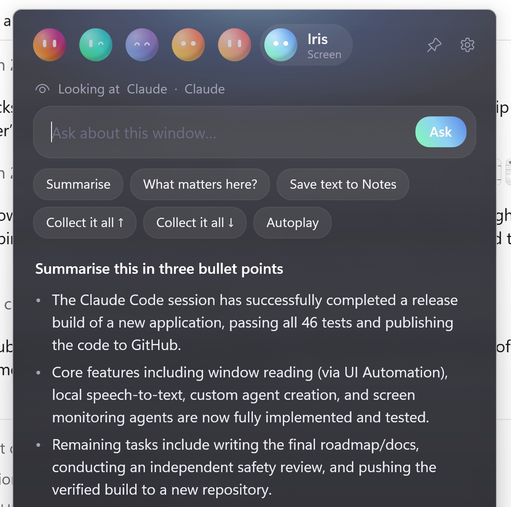
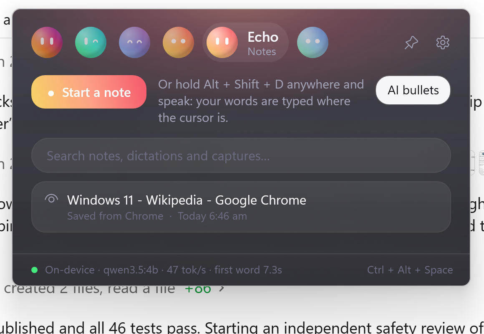

# Mindspace

Small AI helpers that live at the top of your Windows screen and run entirely on your PC.

There is no window to keep open. A sliver sits on the top edge of the screen; hover it and the agents appear, click one and a sheet of frosted glass drops down. Press `Esc` or click away and it is gone.



| Agent | What it does |
|---|---|
| **Quill** · Writer | Drafts emails and messages. In a mail or chat window it reads what is open and drafts the reply; Insert types it in. |
| **Tick** · Reminders | "call mom tomorrow at 5" becomes a reminder as you type. Drops down when one is due. Notices promises in drafts and offers to remind you. |
| **Sage** · Explainer | A short, clear answer to anything, including "explain what's open in Chrome". |
| **Patch** · IT | Live CPU, memory, GPU and VRAM, the busiest processes, and a plain-English verdict. |
| **Echo** · Notes | Voice. Dictate into any app, record notes with a live transcript and optional AI key points, and search everything you said or saved. |
| **Iris** · Screen | Answers questions about the window in front, saves its text, collects a long page or chat by scrolling it, and can keep a runner game going while you are away. |
| **Your own** | Up to three agents you define in Settings: a name, a face, instructions, and the window words that make it lean in. |

## Run it

```bash
dist\Mindspace.exe
```

Needs [Ollama](https://ollama.com) with `qwen3.5:4b` and the .NET 9 Desktop Runtime (both already on this PC). To rebuild: `tools\publish.ps1`.

Voice needs a one-time setup, which downloads the open-source speech engine (already done on this PC):

```bash
powershell -File tools\get-speech.ps1
```

## Using it

| Do this | And this happens |
|---|---|
| Hover the sliver at the top of the screen | The agents appear; click one |
| `Ctrl + Alt + Space` | Open or close the panel |
| Hold `Alt + Shift + D` and speak | Your words are typed where the cursor is. Tap instead of hold to keep listening until the next press |
| Hold `Alt + Shift + D`, say "Tick, remind me to…" | Starting with an agent's name sends the sentence to that agent |
| Select text anywhere, `Alt + Shift + E` | Sage explains the selection |
| Select text anywhere, `Alt + Shift + W` | Quill opens with the selection as the thing to answer |
| `Ctrl + 1…9` in the panel | Switch agent |
| `Esc` or click away | Close (the pin keeps it open) |
| Gear icon | Settings: your agents, voice, models, dock, frosted glass, start with Windows, quit |

Agents also offer help on their own: Quill when a mail or chat window is in front, Sage on docs and reference pages, Patch when CPU or memory stays very high, and your own agents on the window words you gave them. Each offer is one small card that leaves after a few seconds, and each has a cool-down. Turn this off in Settings.

**Bubble dock** (off by default): a floating dock instead of the taskbar. It drops to a sliver when the window you are working in reaches the bottom of the screen and comes back when the pointer touches the bottom edge, so maximised windows get the whole screen.



## What it costs your hardware (measured on this laptop)

| | |
|---|---|
| Download | one 0.5 MB exe, no third-party packages. Voice adds a 5 MB engine and a 141 MB model |
| Idle | 52 MB private memory; about 0.7% of one CPU core with the dock on |
| GPU when idle | none of its own: the UI is software-rendered, and the blur behind the glass is done by the Windows compositor |
| While answering | 2.9 GB VRAM for the model, about 46–50 tokens/s, first word in 0.2–0.4 s when warm |
| While dictating | CPU only, at below-normal priority: about 1 s for a 10 s sentence, 2 s for 30 s |
| After you stop | the model leaves VRAM 3 minutes later; the speech engine exits after every sentence |

The first answer after a long break can take 3–7 seconds while the model loads; hovering the island starts that load early.

## Models

One chat model, `qwen3.5:4b`, serves every agent. It was the smallest of six tested here that passed every task. Dates in reminders are parsed by rules, not a model. Speech is `whisper.cpp` with `base.en`, the fastest of five engine and model pairs tested that still writes punctuation. Details and raw outputs: [docs/RESEARCH.md](docs/RESEARCH.md).

## Safety

Short version: the app talks only to the model server on this PC, agents can only produce text, windows are read only when you ask, and nothing is typed, scrolled or pressed in another app unless you started it. Full list of guarantees and known limits: [SECURITY.md](SECURITY.md).

## Known limits

- Built and tested on one machine (Windows 11, 250% display scaling, primary monitor). The island and dock sit on the primary monitor only.
- Dictation was tested with recorded audio files and by starting and stopping the microphone, not by a person speaking into it. Insert and the hotkeys were tested with simulated key presses against a test window, not against Outlook or Gmail themselves.
- Reading a window depends on the app exposing its text to accessibility tools. It worked here on Chrome and on an Electron app; apps that draw their own text (some games, remote desktops) give nothing. In mail and chat windows the text includes menus and older messages, which a small model can trip over.
- Collect keeps each distinct line once, so a chat that repeats "ok" loses the repeats.
- Autoplay is for side-scrolling jump games at 100% page zoom. It scored over 1,400 in Chrome's offline game in the one long run tested, and does not duck.
- The dock shows running windows, Start and a clock. It has no system tray or pinned apps.
- If another app already owns a hotkey, Mindspace's version silently does nothing; the island still works.
- Small models make mistakes. Read a draft before sending it.

What comes next: [docs/ROADMAP.md](docs/ROADMAP.md).

## Layout

```
src/Mindspace/        the app (C#, WPF, .NET 9)
  Native.cs           every Win32 call, in one file
  Services/           Ollama client, reminders + date rules, system monitor, context sensing,
                      window reader, speech, notes, screen skills
  Views/              one view per agent
tests/                dependency-free tests: dotnet run --project tests/Mindspace.Tests
tools/                bench.mjs (model benchmark), publish.ps1, get-speech.ps1, dev helpers
docs/                 research, roadmap, benchmark outputs, screenshots
```
