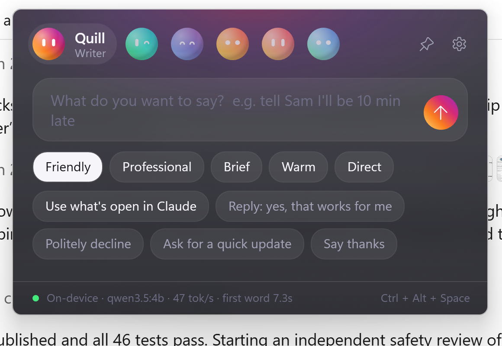

# Mindspace

Four small AI helpers that live at the top of your Windows screen and run entirely on your PC.

There is no window to keep open. A sliver sits on the top edge of the screen; hover it and the agents appear, click one and a sheet of glass drops down. Press `Esc` or click away and it is gone.



| Agent | What it does |
|---|---|
| **Quill** · Writer | Drafts emails and messages. Copy the email you are answering, say "yes, but Wednesday 3pm", press Insert and the reply is typed into your mail app. |
| **Tick** · Reminders | "call mom tomorrow at 5" becomes a reminder as you type. Drops down when one is due. Notices promises in drafts ("I'll send it Friday") and offers to remind you. |
| **Sage** · Explainer | A short, clear answer to anything, with Simpler / Go deeper / Example follow-ups. |
| **Patch** · IT | Live CPU, memory, GPU and VRAM, the busiest processes, and a plain-English verdict. Leans in when the PC has been struggling. |

## Run it

```bash
dist\Mindspace.exe
```

Needs [Ollama](https://ollama.com) with `qwen3.5:4b` (already on this PC) and the .NET 9 Desktop Runtime (also already here). To rebuild: `tools\publish.ps1`.

## Using it

| Do this | And this happens |
|---|---|
| Hover the sliver at the top of the screen | The four agents appear; click one |
| `Ctrl + Alt + Space` | Open or close the panel |
| Select text anywhere, `Alt + Shift + E` | Sage explains the selection |
| Select text anywhere, `Alt + Shift + W` | Quill opens with the selection as the thing to answer |
| `Ctrl + 1…4` in the panel | Switch agent |
| `Esc` or click away | Close (the pin keeps it open) |
| Gear icon | Settings: models, your name, dock, start with Windows, quit |

Agents also offer help on their own: Quill when a mail or chat window is in front, Sage on docs and reference pages, Patch when CPU or memory stays very high. Each offer is one small card that leaves after a few seconds, and each has a cool-down. Turn this off in Settings.

**Bubble dock** (off by default): a floating dock that replaces the taskbar while Mindspace runs.


## What it costs your hardware (measured on this laptop)

| | |
|---|---|
| Download | one 0.4 MB exe, no third-party packages |
| Idle | 45 MB private memory, about 0.2% of one CPU core |
| GPU when idle | none: the UI is software-rendered, so it holds no VRAM and does not wake the RTX 4060 |
| While answering | 2.9 GB VRAM for the model, about 46–50 tokens/s, first word in 0.2–0.4 s when warm |
| After you stop | the model leaves VRAM 3 minutes later |

The model starts loading when you hover the island, so it is usually ready by the time you have typed. The first answer after a long break can still take 3–6 seconds.

## Models

One model, `qwen3.5:4b`, serves all four agents. It was the smallest of six tested here that passed every task; anything under 2 GB misjudged a struggling PC as healthy or wrote clumsy emails. Dates in reminders are parsed by rules, which matched the best model's accuracy instantly and with no GPU. Details and raw outputs: [docs/RESEARCH.md](docs/RESEARCH.md).

## Safety

Short version: the app talks only to the model server on this PC, agents can only produce text, and nothing is typed into another app unless you press Insert. Full list of guarantees and known limits: [SECURITY.md](SECURITY.md).

## Known limits

- Built and tested on one machine (Windows 11, 250% display scaling, primary monitor). The island and dock sit on the primary monitor only.
- Insert and the selection hotkeys were tested against a plain text box with simulated key presses, not against Outlook or Gmail themselves, and not yet by a person.
- The dock shows running windows, Start and a clock. It has no system tray, and maximised windows still leave the taskbar's strip free.
- If another app already owns a hotkey, Mindspace's version silently does nothing; the island still works.
- Small models make mistakes. Read a draft before sending it.

## Layout

```
src/Mindspace/        the app (C#, WPF, .NET 9)
  Native.cs           every Win32 call, in one file
  Services/           Ollama client, reminders + date rules, system monitor, context sensing
  Views/              one view per agent
tests/                dependency-free tests: dotnet run --project tests/Mindspace.Tests
tools/                bench.mjs (model benchmark), publish.ps1, dev helpers
docs/                 research, benchmark outputs, screenshots
```
